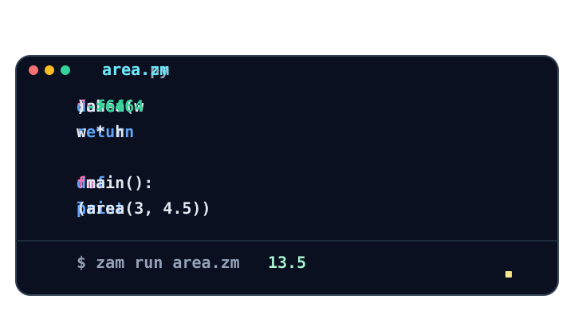
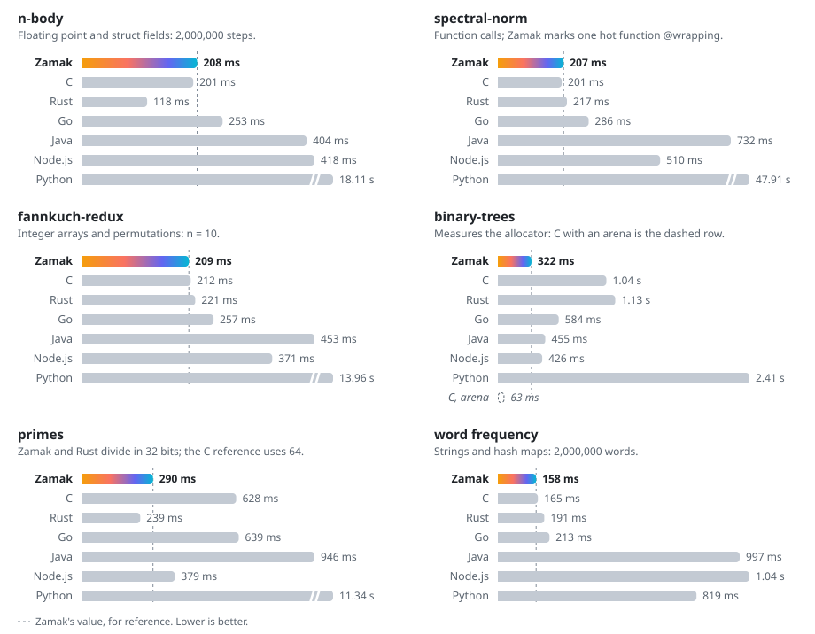
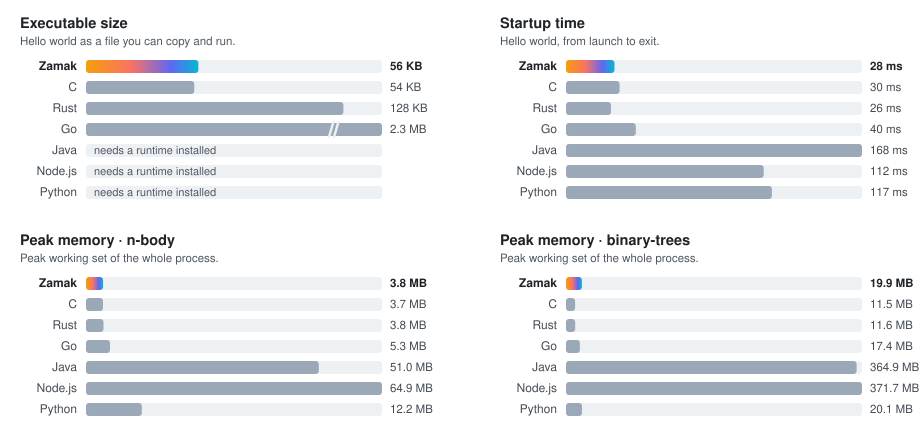

<p align="center">
  <picture>
    <source media="(prefers-color-scheme: dark)" srcset="docs/logo-dark.svg"/>
    
  </picture>
</p>

<p align="center">
  <strong>English</strong>
  &nbsp;·&nbsp;
  <a href="./README.zh-CN.md">简体中文</a>
  &nbsp;·&nbsp;
  <a href="#why-zamak">Why Zamak</a>
  &nbsp;·&nbsp;
  <a href="https://zamak.veyralux.org/">The Zamak Book</a>
  &nbsp;·&nbsp;
  <a href="#language-tour">Language tour</a>
  &nbsp;·&nbsp;
  <a href="./editors/vscode">VS Code</a>
  &nbsp;·&nbsp;
  <a href="https://github.com/VeyraLux/zamak-index">Packages</a>
</p>

<p align="center">
  <a href="https://github.com/VeyraLux/Zamak/actions/workflows/ci.yml"></a>
  <a href="#license"></a>
  
  
  <a href="https://github.com/VeyraLux/Zamak/stargazers"></a>
</p>

<br/>

<p align="center"><strong>Open source · Native code · Ownership without garbage collection</strong></p>
<h3 align="center">Written with clarity. Compiled with precision.</h3>
<p align="center">Zamak is a statically typed language for people and AI agents alike. Its syntax stays light and familiar. Its compiler produces standalone native executables. Ownership manages memory without a garbage collector, and every error comes with a stable code and a fix you can act on.</p>
<p align="center">Created by <strong>rayL-K</strong> · <strong>VeyraLux</strong></p>

<br/>

## Why Zamak

**Reads like Python. Runs like C. Safe without a garbage collector.**

<p align="center">
  
</p>

| As fast as C | 56 KB hello world | 20 MB where Java uses 365 MB | No lifetime annotations | Overflow checked in release builds |
| :---: | :---: | :---: | :---: | :---: |

Zamak brings these together in one language. The numbers come from benchmarks you can run yourself; see [How Zamak compares](#how-zamak-compares) and [Features](#features).

- **Python's readability at C's speed.** Zamak reads like Python: `for i in range(n)`, `xs[-1]`, `f"..."`, and Python's division rules. It compiles to native code that matches or beats C on spectral-norm, fannkuch-redux, and primes, and runs compute-bound programs 46 to 217 times faster than Python.
- **Memory safety you don't have to fight.** Ownership rules out use-after-free and double frees at compile time, with no garbage collector. Read-only borrows happen automatically, a borrow lasts at most one block, and you never write lifetime annotations. When the checker does reject code, the error names the problem and suggests the fix.
- **Safer integer math than C, Rust, or Go.** Integer overflow, division by zero, and out-of-bounds indexes stop the program with a clear error in every build, including release builds. The compiler removes the checks it can prove unnecessary, so safe code still runs at C speed, and `@wrapping` turns checks off in one function when you want wrapping, such as in a hash.
- **Small programs with a small footprint.** A hello world is 56 KB, about the size of C's and 1/40 of Go's. On binary-trees, Zamak is the fastest of the seven languages tested and uses 20 MB, where Java and Node.js use more than 360 MB.
- **Built for AI coding agents.** The whole language fits in a one-page reference that agents read before they write code. Every diagnostic has a stable code and a suggested fix, also as JSON, and `zam new --template ai` sets up a project with a skill file for your agent.
- **Fast feedback.** `zam check` finishes in less than 0.1 seconds on a 5,000-line project, and a one-line edit rebuilds in under a second, because `zam` caches every module by content.

### Compared with popular languages

Each popular language asks you to give something up, and Zamak is designed so that you don't have to choose:

- **Python** is easy to read and write, but it's slow, it needs an interpreter on every machine, and it finds type errors only when the code runs.
- **C** is fast and small, but one wrong index or integer overflow silently corrupts memory.
- **Rust** is fast and memory safe, but lifetimes and the borrow checker take a long time to learn, and its release builds don't check integer overflow.
- **Go** is simple and safe, but it ships a garbage collector, and a hello world is 2.3 MB.
- **Java** and **Node.js** need a large runtime, and they use hundreds of megabytes on allocation-heavy work.

### When to choose something else

Zamak is a prototype. It doesn't support threads or networking yet, and its package ecosystem is just starting. For production services, large existing codebases, or work that depends on mature libraries, use an established language today, and try Zamak for command-line tools, data processing, learning, and code that AI agents write.

## Example

This program counts how often each word appears in its input:

```zamak
use std/io

fn main() -> !string:
    let text = io.read_all()?
    let mut counts: {string: i64} = {}

    for word in text.words():
        counts[word] = counts.get(word, 0) + 1

    for word, n in counts:
        print(f"{word}: {n}")
```

```text
$ echo "to be or not to be" | zam run count.zm
to: 2
be: 2
or: 1
not: 1
```

> [!NOTE]
> Zamak is a prototype (version 0.1.0). Use it to learn, experiment, and write small command-line tools. Syntax and cache formats might change, so don't use it in production yet.

## Features

- **Familiar syntax.** If you have written Python, you can read Zamak without adjusting. `len(xs)`, `for i in range(n)`, `x in xs`, `a if c else b`, `xs[-1]`, `xs[1:3]`, `sum(xs)`, `sorted(xs)`, `int(s)`, `str(n)`, `2 ** 10`, `f"..."`, and `#` comments mean what they mean in Python. Division follows Python too: `7 / 2` is `3.5`, `7 // 2` is `3`, and `-7 % 2` is `1`. Strings count characters, so `len("你好")` is 2.
- **Ownership without a garbage collector.** Strings, structs, lists, and maps move when you assign them. Passing a variable to a read-only parameter borrows it automatically, as in `show(name)`; a function that changes its argument says so at the call site with `&mut x`. A borrow lasts for one call, or until the end of the block for a read-only local such as `let entry = &entries[i]`, so you never write lifetime annotations. Zamak checks integer overflow, division by zero, and out-of-bounds access at run time, and it removes the checks that a conservative range analysis proves redundant. For a hot function where wrapping is intended, such as a hash, write `@wrapping` above `fn` to turn off overflow checks in that function only.
- **Fast feedback.** `zam check` checks types and ownership without calling a C compiler. `zam build` caches each module by content, so a one-line edit rebuilds only the module you changed. On the project's 10-module, 5,250-line benchmark (Windows, MSVC, one machine), a one-line edit rebuilds in about 0.75 seconds, and `zam check` finishes in less than 0.1 seconds. For the method and raw numbers, see [docs/ENGINEERING.md](docs/ENGINEERING.md) and [docs/PERFORMANCE.md](docs/PERFORMANCE.md) (in Chinese).
- **Diagnostics built for tools.** Every error has a stable code such as `ZM301`, a category, a position, and usually a suggested fix. If you use a Python spelling that Zamak writes differently, the message shows the Zamak spelling. `zam check --json` writes the diagnostics as one line of JSON. Zamak reports type errors per function, so an agent can fix several of them in one pass.
- **Learnable from one page.** In a benchmark with three models and eight small command-line tasks, each model read only a one-page language reference. The models solved all 24 Zamak tasks, 21 of them on the first try. The three other first attempts had a missing import, a missing `?`, and a borrowed local. Zamak now names the missing `use` line and allows read-only borrows in locals, but the benchmark hasn't been rerun since. The Rust and Go versions passed 23 and 24 tasks on the first try, so these tasks are too easy to rank the languages. For the method, tasks, and data, see [bench/ai/live](bench/ai/live/README.md).
- **Native, standalone output.** Zamak generates C and compiles it with Microsoft C++ (MSVC), GCC, or Clang. The executable runs without Zamak or Rust installed. On the integer benchmarks in [docs/PERFORMANCE.md](docs/PERFORMANCE.md), its runtime performance is in the same range as Rust and Go.

## How Zamak compares

Zamak brings together what C, Rust, Go, and Python each do best. These charts run the same programs in each language on one machine: four from [The Computer Language Benchmarks Game](https://benchmarksgame-team.pages.debian.net/benchmarksgame/) and two everyday tasks. Shorter bars are better.

<p align="center">
  <picture>
    <source media="(prefers-color-scheme: dark)" srcset="docs/compare-speed-dark.svg"/>
    
  </picture>
</p>

<p align="center">
  <picture>
    <source media="(prefers-color-scheme: dark)" srcset="docs/compare-footprint-dark.svg"/>
    
  </picture>
</p>

| | Zamak | C | Rust | Go | Python |
| --- | :---: | :---: | :---: | :---: | :---: |
| Memory safe by default | ✓ | ✗ | ✓ | ✓ | ✓ |
| No garbage collector | ✓ | ✓ | ✓ | ✗ | ✗ |
| Integer overflow checked in release builds | ✓ | ✗ | ✗ | ✗ | not needed |
| Array bounds checked | ✓ | ✗ | ✓ | ✓ | ✓ |
| Standalone native executable | ✓ | ✓ | ✓ | ✓ | ✗ |
| No lifetime annotations | ✓ | ✓ | ✗ | ✓ | ✓ |

Zamak runs in the same range as C on every compute-bound program here, while it checks overflow and bounds by default. It's the fastest of the seven languages on binary-trees, and it counts words faster than Rust and Go. Its one opt-out is `@wrapping` on the spectral-norm hot function, which turns off overflow checks for that function only. For the method, the full results, and how to run the benchmark yourself, see [bench/compare](bench/compare/README.md).

## Use Zamak with your AI agent

Zamak treats AI coding agents as first-class readers. To start a project that your agent can work on right away, run:

```sh
zam new hello --template ai
```

The project includes:

- **`.claude/skills/zamak/SKILL.md`**, a skill that Claude Code loads whenever it reads or writes Zamak.
- **`AGENTS.md`**, the same guide for Codex, Cursor, GitHub Copilot, and other agents that read `AGENTS.md`.

Both files contain the check-fix loop and the one-page language reference, so your agent writes Zamak correctly from its first line. They come from the reference built into `zam`, so a new project always matches the version you have installed.

While it works, your agent reads diagnostics from `zam check --json`. Every diagnostic has a stable code, such as `ZM301`, a position, and usually a suggested fix.

An MCP server (`zam mcp`) that lets agents check, build, and run code and look up the standard library is planned.

## Quickstart

You need Rust stable and a C compiler. For the compiler that each platform uses, see [Install Zamak](#install-zamak).

```sh
cargo install --path zam --locked   # Run in the repository root.
zam new hello                       # Creates hello/zam.toml and hello/src/main.zm.
zam run hello                       # Prints "hello from zamak".
```

## Install Zamak

To build Zamak from source, you need Rust stable and a C compiler. In the repository root, run:

```sh
cargo install --path zam --locked
```

Zamak finds a C compiler on each platform as follows:

| Platform | C compiler |
| --- | --- |
| Windows x64 | Visual Studio Build Tools with the **Desktop development with C++** workload, located through `vswhere`. If it isn't installed, Zamak uses `gcc` (for example, MinGW-w64) or `clang` from `PATH`. |
| Linux | `cc`, `clang`, or `gcc` from `PATH`. On Debian and Ubuntu, install `build-essential`. |
| macOS | Xcode Command Line Tools. To install them, run `xcode-select --install`. |

To choose a GCC-style compiler yourself, set the `CC` environment variable. `zam check` doesn't need a C compiler. Continuous integration (CI) runs the full test suite on all three platforms.

## Create your first project

```sh
zam new hello        # creates hello/zam.toml and hello/src/main.zm
zam run hello        # prints: hello from zamak
zam check hello      # type and borrow check only
zam fmt hello        # normalizes indentation
zam test hello       # runs every fn test_...() in the project
zam build hello      # writes build/hello-<hash>(.exe)
zam run app.zm -- a b   # pass arguments to the program
```

`zam` writes build progress to standard error, so standard output contains only your program's output.

## Language tour

This program uses structs, error values, lists, maps, and string interpolation:

```zamak
use std/string

struct Person:
    name: string
    age: i64

# Errors are values: `T!string` returns either a T or an error message.
fn parse_age(text: &string) -> i64!string:
    let age = string.parse_i64(text)?

    if age < 0:
        fail "age must not be negative"

    age

fn main() -> !string:
    let mut ages: {string: i64} = {}
    let mut names: [string] = []

    for i in 0..3:
        names.push("user{i}")

    for name in &names:
        ages[name] = string.byte_len(name) * 10

    let raw = "42"
    let age = parse_age(&raw) catch e:
        println("bad input: {e}")
        return
    let p = Person(name: "Ada", age: age)
    println("{p.name} is {p.age}")
```

- **Blocks.** Blocks use indentation, like Python. A line that ends with `:` opens a block, and the block's lines are indented 4 spaces deeper. A block with one statement can stay on the same line, such as `if n < 1: return n`. Write `pass` for an empty block. Braces only appear in maps and string interpolation. Indent with spaces; `zam fmt` replaces tabs and normalizes indentation and blank lines.
- **Types.** Zamak has `i64`, `f64`, `bool`, `string` (UTF-8), named structs, fixed arrays `[i64; N]`, lists `[T]`, and maps `{K: V}`. List elements and map values can be `i64`, `f64`, `bool`, `string`, a struct, or another list or map, such as `[[i64]]` or `{string: [string]}`, and map keys can be `i64` or `string`. `grid[i][j]` reads and writes an inner element. Lists have `push`, `pop`, `insert`, `remove`, `sort`, `sorted`, `sort_by`, `reverse`, `contains`, `index_of`, `slice`, `sum`, `min`, `max`, and `extend`, and `xs[-1]` and `xs[a:b]` index and slice as in Python; maps have `get`, `contains`, `remove`, `keys`, and `values`. A character literal such as `'#'` is an `i64` code point.
- **Numbers.** Mixing `i64` and `f64` converts the integer to `f64`, as in Python, so `price * count`, `let x: f64 = 1`, and `area(2)` work. `/` always gives an `f64`, `//` is floor division, `%` takes the sign of the divisor, and dividing by zero stops the program. Convert explicitly with `f64(n)` or `i64(x)` (also spelled `float(n)` and `int(x)`), where `i64(x)` truncates toward zero. `println` prints the shortest text that reads back as the same `f64`, such as `0.1` or `2.0`, and `fmt.fixed(x, 2)` rounds to two decimal places.
- **Structs.** Declare `struct Point:` with one field per indented line, and build a value with `Point(x: 1, y: 2)`, naming every field. Function names start with a lowercase letter, so `Point(...)` always means a struct.
- **Methods.** Write methods inside the struct or enum block with `&self`, `&mut self`, or `self` as the first parameter, and call them as `p.norm()`. A function without `self`, such as `Point.new(1, 2)`, is called on the type.
- **Struct borrows and struct lists.** A parameter typed `&Point` borrows a struct for one call, and `&mut Point` lets the function change it. In a list of structs, read or write a field with `items[i].qty`, borrow an element with `&items[i]`, and loop with `for item in &items`. Structs move on assignment, so take an element out with `items.pop()` or make a deep copy with `copy(&items[i])`. Structs, enums, lists, and maps compare with `==` and print with `println`, as in `Point(x: 1, y: 2)`.
- **Enums and match.** Declare `enum Shape:` with one variant per indented line, such as `Circle(r: f64)` or `Empty`, and build values with `Shape.Circle(1.0)` or `Shape.Empty`. A `match` lists one arm per line, such as `Circle(r): 3.14 * r * r`, or ends with `_: ...`. Zamak reports an error when an arm is missing. A `match` borrows the value, so arms read the data without moving it. A `match` can also branch on integers, strings, and booleans, as in `1 | 2: "small"`.
- **Control flow.** Use `if`, `elif`, `else`, `while`, `break`, and `continue`. To choose a value, write `let v = a if c else b` or `let v = if c: a elif d: b else: e`. Combine conditions with `and`, `or`, and `not`, which follow Python's precedence and short-circuit. Loop over a range with `for i in range(n)` or `for i in 0..n`, over a list with `for x in list` or `for i, x in list`, over a call result such as `for name in fs.list(dir)?`, and over a map in insertion order with `for k in &map` or `for k, v in &map`. Write `&mut` to change elements in place, as in `for x in &mut list: x += 1`.
- **Errors.** A function that can fail returns `T!E` or `!E`, where `E` is `string`, a struct, or an enum. Use `fail` to return an error, `?` to pass it to the caller, and `catch e:` followed by an indented block to handle it in place, for example with `match e`. When the call's value is used, the block must leave with `return`, `fail`, `break`, or `continue`; when it isn't, as in `fs.remove(&p) catch e:`, the program continues after the block.
- **Generic functions.** Write `fn largest[T](items: &[T]) -> T`. Zamak infers `T` at each call and compiles a separate version per type.
- **Generic types and Option.** Declare `struct Stack[T]` or `enum Tree[T]` and write the type as `Stack[string]`. Methods inside a generic type can use `T`. The built-in `Option[T]` has the variants `Option.Some(value)` and `Option.None`.
- **Function values.** A function type is written `fn(i64) -> bool`. Pass a named function by name, or write an anonymous fn such as `fn(x): x * 2`. For longer code, declare a `fn` inside the function body. Closures can read the enclosing function's variables and change the ones declared with `let mut`. A closure can be called, bound with `let`, and passed as an argument, but never stored or returned, so it never outlives the variables it uses and no garbage collector is needed. Lists and maps can hold functions, such as `[fn(i64) -> i64]`, and a generic function becomes a value when the expected function type is known. Call an element directly with `steps[0](x)`. A function type can fail, as in `fn(&string) -> i64!string`; calls through such a value need `?` or `catch` like any other failing call.
- **Tests.** `assert cond` or `assert cond, "message"` stops the program when `cond` is false and prints the condition, and for `a == b` both values. `zam test` runs every function named `test_...` in its own process, so a crash fails only that test, and prints a summary. Pass a word to run only matching tests: `zam test . parse`.
- **Tuples.** Group values as `(3, "three")` with type `(i64, string)`, read items with `t.0`, and return several values from a function: `let (q, r) = divmod(17, 5)`.
- **Constants.** Declare `const LIMIT = 100` at the top level. Zamak computes the value at compile time from literals, earlier constants, and operators.
- **Modules.** Each file is a module. Import one with `use name`, and export items with `pub fn`, `pub struct`, and `pub const`.
- **Packages.** Find libraries in the [package index](https://github.com/VeyraLux/zamak-index) with `zam search json`, and add one with `zam add mathx`, which writes `mathx = "^1.4.0"`. Version requirements follow Cargo: `^1.2`, `~1.2`, `=1.2.3`, or `>=1.0, <2.0`, and `zam` picks the highest version every package accepts. Remove a dependency with `zam remove mathx`. You can also add a library straight from a Git repository with `zam add mathx https://github.com/you/mathx v1.0`, or from a local directory with `zam add util ../util`. To share your own library, give `zam.toml` a `version`, tag it, and run `zam publish`. `zam.toml` lists dependencies under `[dependencies]`, and `zam.lock` pins each Git dependency to a commit so every build uses the same code, offline too. Import a package's modules as `use mathx` or `use mathx/geo`. Run `zam update` to move to the latest commit of each `rev`.
- **C libraries.** Declare a C function with `extern fn sqrt(x: f64) -> f64` and call it like any other function. Parameters can be `i64`, `f64`, `bool`, or `&string` (passed as a `const char *` that ends with `\0`), and results can be those types or `string`. List C files, include directories, and libraries in a `[native]` section of `zam.toml`, such as `sources = ["c/shim.c"]` and `libraries = ["sqlite3"]`. A package can carry its own `[native]` section, so a Zamak library can wrap a C library for other projects. See `examples/ffi`.
- **Operators.** Arithmetic uses `+`, `-`, `*`, `/`, `//`, `%`, and `**`, and `x in xs` tests membership in a list, a map, or a string. Integers support the bitwise operators `&`, `|`, `^`, `~`, `<<`, and `>>` with Python's precedence, and literals such as `0xFF`, `0b1010`, and `0o17`.
- **Strings.** Call string functions as methods, such as `name.upper()`, `line.trim().len()`, or `csv.split(",")`, without an import. As in Python, `len(s)`, `s[i]`, `s[a:b]`, and `s.find(x)` count characters (`len("你好")` is 2), `for ch in s` loops over characters, methods work on literals (`", ".join(words)`, `"a,b".split(",")`) with Python names such as `strip`, `startswith`, and `isdigit`, and `byte_len`, `byte_at`, `byte_slice`, and `byte_find` work in UTF-8 bytes. Join strings with `+`, compare them with `==` or `<`, slice them with `s[a:b]`, and update variables with `+=`, `-=`, `*=`, `/=`, `//=`, and `%=`. Interpolation accepts expressions such as `"{a + b}"` and `"{xs[0]}"`.
- **Printing.** `print(x)` and `println(x)` both print a value and a newline, like Python's `print`. `io.print` prints without a newline.
- **Standard library.** `std/io` reads standard input and prints to standard output or standard error, `std/fs` reads, writes, and appends files, lists and creates directories, and renames and removes entries, `std/path` joins and splits paths, and `std/env` reads arguments and environment variables and sets the exit status. Python's `len`, `str`, `int`, `float`, `abs`, `min`, `max`, `sum`, and `sorted` need no import. `std/string` measures, compares, parses, trims, searches, replaces, converts case, slices, splits, joins, pads, and repeats strings, and converts them to and from characters, code points, and UTF-8 bytes. `std/math` provides square roots, powers, logarithms, trigonometry, rounding, and the constants `math.pi`, `math.e`, and `math.inf`. `std/time` reads the clock, measures durations, sleeps, and formats dates, and `std/random` draws integers and floats, with `random.seed(n)` for repeatable runs.

[The Zamak Book](https://zamak.veyralux.org/) covers every feature with runnable examples, in English and Chinese. For a larger program, see [examples/md2html](examples/md2html), a Markdown-to-HTML converter with four modules and about 270 lines. It handles headings, lists, quotes, fenced code, inline formatting, links, and HTML escaping. To run it:

```sh
zam run examples/md2html -- examples/md2html/sample.md
```

## Diagnostics

When a check fails, `zam` shows the error code, the location, the source line, and a suggested fix:

```text
error[ZM301]: use after move: name
 --> moved.zm:8:5
  |
8 |     println(name)
  |     ^^^^^^^^^^^^^
  = help: borrow the value or move it only after the last use
```

On a system set to Chinese, `zam` shows the same diagnostic in Chinese. Set `ZAMAK_LANG` to `en` or `zh` to choose the language yourself.

`zam check --json moved.zm` reports the same error as one line of JSON, always in English:

```json
{"command":"check","ok":false,"diagnostics":[{"file":"moved.zm","line":8,"column":5,"function":"main:main","code":"ZM301","category":"ownership","message":"use after move: name","suggestion":"borrow the value or move it only after the last use"}]}
```

For the list of error codes and the recommended loop for AI agents (check, make the smallest fix, format, check, build, and run), see [docs/AI_WORKFLOW.md](docs/AI_WORKFLOW.md) (in Chinese).

## Current limitations

Zamak doesn't support threads or networking yet. C functions take and return only numbers, booleans, and strings; pass pointers and structs through a small C wrapper. There's no read-eval-print loop (REPL) yet. When you use an unsupported construct, `zam check` reports a diagnostic instead of compiling incorrect code.

## Editor and agent support

- **VS Code.** The extension in [editors/vscode](editors/vscode) adds syntax highlighting and runs `zam lsp`, the Zamak language server, for diagnostics as you type, completion, hover, go to definition, and formatting. Other editors that support the Language Server Protocol can run `zam lsp` too.
- **AI coding agents.** [.agents/skills/zamak/SKILL.md](.agents/skills/zamak/SKILL.md) describes the commands, syntax, and common diagnostics for agents that read `.agents/skills`.

## Contribute

For the development guide, see [CONTRIBUTING.md](CONTRIBUTING.md) (in Chinese). Before you submit a change, make sure these commands pass in the `zam` folder:

```sh
cargo test --locked
cargo fmt --check
cargo clippy --all-targets --locked -- -D warnings
```

## License

You can use Zamak under either the [MIT license](LICENSE-MIT) or the [Apache License 2.0](LICENSE-APACHE). Unless you state otherwise, you license your contributions under the same terms.
